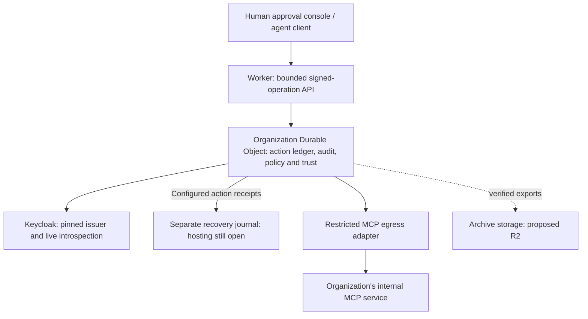

# Cloudflare-native XEIP: feasibility and migration

Date: 11 October 2026. Status: **local Worker, durable ledger/trust/authority, private audited administration, automatic refresh and manual administrative archives implemented; hosted acceptance remains open**. The user selected exploration after confirming that no dedicated staging host exists. This is an alternative to the Linux/PostgreSQL deployment, not evidence that the existing image runs unchanged on Workers.

## Private Cloudflare smoke

The approved isolated `xeip-staging-20261011` deployment passed its first private operator status call on11 October2026: uninitialized, no trust or authority state. Public routes, preview URLs and Cron are disabled. Only synthetic configuration credentials were installed; no organization was initialized. Current version `4f93b791-03ca-4652-9df9-3a446eb9e62d`. [Exact scope and evidence](../plans/cloudflare-staging.md). This proves hosted private startup and binding access only; production remains no-go.

## Recovery JSON regression fixes

Measured nesting/string parsing overhead caused the maximum16MiB recovery request to exceed its deadline. Two local parsing optimizations preserve strict JSON and existing limits; the uninstrumented maximum-size check has passing macOS/Linux evidence, but a later macOS rerun timed out again. Completion at the deadline remains unaccepted. SDK/root/organization/interoperability suites pass. Both full platform snapshots ended524/525 before the test-fixture correction; neither is a full passing run. The startup failure was traced to a recreated test journal losing its memory-only HTTP handler. A deterministic restart regression failed before the fixture correction and passes afterward; current Linux affected-file verification passes60/60 plus strict types. [Measurements and evidence](2026-10-11-recovery-json-performance.md).

## Isolated action database reconstruction

The [fenced reconstruction module](../../services/organization/cloudflare/ACTION_RESTORE.md) now rebuilds exact action rows, approvals, consumed claims, outcomes and audit from a journal bundle into a separate empty native SQLite database. Schema8 permanently blocks normal activation of the candidate, including after successful verification or restart. Existing schema7 data and migration definitions are preserved. No production restore entrypoint is exposed.

Focused evidence passes79/79 restore/archive/action-recovery cases plus strict types,100 format-compatibility comparisons, and the signed Worker→journal→bundle→isolated candidate integration. Scoped review found no Critical/Important defects; its minor documentation finding is fixed. Exact Worker/scheduler dry-runs and the rebuilt Linux image checks pass. Full platform acceptance remains open. Earlier macOS515/524 and Linux508/524 failures are preserved in the ledger. After fixture corrections and parsing optimization, macOS passed524/525; its sole failure was the journal-fixture recreation defect diagnosed and corrected above. The new restart regression and original failing case pass2/2, followed by current Linux affected-file checks60/60 and strict types passing. The [execution ledger](../plans/cloudflare-action-restore.md) preserves all evidence. No performance conclusion follows from these contended runs.

This implements action reconstruction; broad regression acceptance remains open. Trust/authority/admin recovery, coordinated current-journal reconciliation and external execution fencing, independent hosted journal/IAM/TLS, retention and hosted workload/recovery/security/operator acceptance remain required. A verified candidate stays unavailable and a periodic bundle cannot cover newer acknowledged actions.

## Complete journal bundles and offline action evidence

The [recovery bundle collector](../../services/organization/cloudflare/RECOVERY_ARCHIVE.md) captures a fixed complete journal prefix through authenticated reads, verifies every payload and chain link, and seals protected files only after synchronization. Prior verified bundles constrain prefix continuity. Separate offline action interpretation checks exact successive histories and preserves consumed claims without executing anything. The CLI reads credentials only from a bounded private file and prints identifiers/counts.

Focused tests cover multipart/full16MiB payloads, journal advancement, corruption, prior rollback/forks, protected files, failures/deadlines, semantic continuity and the actual signed Worker workflow with one consumed claim. Final verification passes **500/500 on macOS and498/498 full-suite cases plus2/2 closing checks on pinned Node22/Linux**, with strict types on both. The scoped review found no defects; Worker/scheduler dry-runs and the rebuilt Linux image integrity/startup smoke pass. Exact evidence and limits are maintained in [the implementation ledger](../plans/cloudflare-recovery-archive.md). This is a recovery prerequisite; complete source restore, trust/authority/admin recovery, hosted independence/IAM, retention and production acceptance remain open. A periodic bundle cannot protect newer acknowledgements beyond its cut.

## Source Worker recovery configuration

The experimental organization Worker now accepts an optional public recovery profile and separate secret. It constructs the authenticated HTTPS client, persists the exact public endpoint and normalized enrollment, and rejects omission/drift on reopen. Explicit private initialization requires an already initialized empty journal; public traffic cannot create or reset it. Credential rotation and runtime timeout changes preserve identity.

The focused integration verifies signed proposal, approval, claim and completion, remote durability before tool execution, lost receipts, restart, changed settings and secret correction. It also exposed and corrected rejection of valid decoded HTTP chunked responses while retaining strict framing and size checks. The exact recovery-enabled artifact executes the same native workflow. Final verification passes **467/467 native cases and strict types on macOS and pinned Node22.23.3/Linux**. The scoped review found no defects; actual Wrangler startup/private status, Worker/scheduler dry-runs and exact artifact integrity checks pass. The existing Linux image remains applicable with47 matching shared runtime files and unchanged root manifests, and passes its isolated startup smoke. Evidence and limits are recorded in [the implementation ledger](../plans/cloudflare-worker-recovery.md).

This source integration is not a hosted journal or complete recovery system. Independent journal hosting/enrollment/IAM, full restore and trust/authority/admin recovery, retention and hosted workload/security/operator acceptance remain open. That source-integration increment created no cloud resources; the later private smoke is recorded above. Keycloak and the Linux deployment remain available.

## Recommendation

Prototype **Workers + SQLite-backed Durable Objects** for XEIP's signed approval API and authoritative action/trust state. Preserve Keycloak initially and connect to the actual internal MCP service through a separately tested private-service boundary. This removes the XEIP application VM and its PostgreSQL administration if the prototype succeeds; it does not remove the hosting needs of Keycloak or the internal tool.

This is organization-controlled cloud hosting, not the previously selected fully self-hosted deployment. Cloudflare operates the compute and storage, and this adapter introduces platform dependence. Keep the existing Linux implementation available. The user has approved exploration, not this trade-off as a production decision. A separate identity preference is pending; keep the existing Keycloak choice until changed.

The acceptance targets remain 500 users, 200 agents, 120 requested actions/minute, machine-operation P95 ≤2 seconds, restore ≤1 hour and no loss of acknowledged actions. No Cloudflare capacity or recovery experiment has run. The failed workstation run remains valid evidence about that environment only.

## Options considered

| Route                                               | Reuse and work                                                                                                           | Assessment                                                                                                 |
| --------------------------------------------------- | ------------------------------------------------------------------------------------------------------------------------ | ---------------------------------------------------------------------------------------------------------- |
| Cloudflare DNS/security in front of a Linux host    | Reuses the current service, PostgreSQL and Keycloak; proxy ingress needs a new verified trust profile                    | Smallest application change, but still needs a host. Retain as fallback.                                   |
| Workers + Hyperdrive + externally hosted PostgreSQL | Reuses ledger concepts, but needs a Workers transport, persistent trust adapter and database-session compatibility tests | Transitional option; Hyperdrive connects to an existing database, it does not eliminate that database.     |
| Workers + Durable Objects                           | New transport/storage/trust adapters and recovery certification; retains signed protocol and policy semantics            | Recommended native feasibility target. Highest initial implementation cost; fewer XEIP servers to operate. |

[Hyperdrive documentation](https://developers.cloudflare.com/hyperdrive/) describes acceleration and pooling for existing databases. Its compatibility claims do not establish compatibility with XEIP's direct-login privilege checks, transaction settings or uncached authorization reads.

Cloudflare Containers can run container workloads, but their disks are ephemeral by default. Snapshots and FUSE options exist; neither is evidence of compatibility with XEIP's fsync/rename checkpoint or PostgreSQL recovery contract. Running the current image there would still require deliberate persistent-state design. [Container lifecycle](https://developers.cloudflare.com/containers/concepts/architecture/).

## Candidate architecture



Solid arrows describe request dependencies, not deployed infrastructure. When recovery is configured, the separate journal is on the action acknowledgment and claim path; archives remain outside that path. Neither local fixtures nor asynchronous archives establish a hosted zero-loss guarantee.

For the **bounded prototype**, use one configured organization object so policy, trust high-water marks, action transitions and audit share one consistency boundary. Do not let callers choose another organization/object identifier. This keeps local revocation ordering testable and avoids inventing a distributed authorization transaction during the first port. It is not the final retention/scaling design.

Cloudflare documents strongly consistent transactional object storage, synchronous SQL transactions, output gates that delay external messages until preceding writes persist, and an explicit storage sync operation. SQLite-backed objects also support 30-day point-in-time recovery; that recovery API is unavailable in local development. These are platform properties to exercise, not XEIP test results. [Storage API](https://developers.cloudflare.com/durable-objects/api/sqlite-storage-api/).

### Request and execution behavior

1. The Worker enforces method, configured hostname/origin, content type, streamed byte limits, UTF-8 and deadlines. It forwards the original signed payload and bearer only through a private binding; forwarded identity headers are not authority. Authenticated responses are not cached. The object performs authoritative identity/signature checks.
2. The object validates the pinned issuer, audience, explicit subject/entity/device mapping and live provider status. Reuse exact envelope/digest fixtures. No client bearer or refresh token enters persistent storage or logs.
3. Before an asynchronous check, capture the relevant local policy/trust/action revision. After it resolves, reread current state; reject stale revisions or repeat the bounded check. Perform final local eligibility checks and state-plus-audit writes synchronously in one transaction. Never hold a SQL cursor across an asynchronous operation or place network effects inside a retriable transaction callback.
4. Approval remains explicit consent to the exact target revision, tool, arguments, digest and expiry. The requester cannot approve their own action. Disabling an approver's login does not retroactively revoke an existing consent grant; preserve the current action/membership/key revocation rules.
5. Persist a single-use execution claim before any effect. When recovery is configured, confirm the exact claim in the separate journal before releasing it. After the durability wait, recheck current policy, trust, expiry and provider status at the connector's pre-send boundary. The checks must not rely solely on the earlier snapshot.
6. Send at most one MCP `tools/call` attempt under the current contract, then persist the outcome and confirm its recovery receipt when configured. A crash or lost response after sending remains indeterminate. Inspect may recover a recorded result; restart, alarm, queue delivery and client retry must not issue the effect again.

This ordering ports the existing `store.mjs`, `authorization.mjs` and `execution.mjs` behavior. Native workerd tests now exercise concurrency, cancellation, uncertain receipts and restart; hosted fault acceptance remains open. The Node service's drain/signal model does not transfer to serverless execution. Disconnect/eviction must leave a durable claim, even if result recording cannot finish.

### What each Cloudflare service would own

| Service                               | Proposed use                                             | Constraint                                                                              |
| ------------------------------------- | -------------------------------------------------------- | --------------------------------------------------------------------------------------- |
| Workers and static assets             | API ingress and future human approval console            | New ingress adapter; preserve explicit signed authorization and PKCE/device enrollment. |
| SQLite-backed Durable Objects         | Authoritative action, claim, audit and trust state       | New migrations and storage adapter; capacity, retention and recovery gates required.    |
| R2                                    | Optional verified export/archive destination             | Archive/checksum/retention and restore protocol not yet designed or implemented.        |
| Queues / Workflows                    | Optional notifications or export scheduling later        | Not automatic retries of non-idempotent tool effects.                                   |
| Workers KV                            | Optional non-security preferences/cache                  | Not authoritative revocation, consumed claims or trust high-water marks.                |
| D1                                    | Possible later reporting projection                      | Not an additional authoritative ledger in the first prototype.                          |
| Access / private-service connectivity | Optional perimeter and restricted routes to Keycloak/MCP | Does not replace XEIP identity mapping, signatures or approval.                         |

The KV restriction follows its eventual consistency; updates can take 60 seconds or more to appear elsewhere. [KV consistency](https://developers.cloudflare.com/kv/concepts/how-kv-works/). Queues delivers at least once, so duplicate delivery must be expected. [Queues delivery guarantees](https://developers.cloudflare.com/queues/reference/delivery-guarantees/). These are architectural reasons to keep authority in the object, not general claims that those services are unsuitable.

Workers VPC can connect to private infrastructure, but the documentation currently labels it beta. Treat it as an evaluated connector option, not a production dependency selected by default. Test pinned HTTPS/OAuth behavior, redirects, failures and exact destination restriction through the chosen transport. The private network still needs a reachable connector and the internal tool still needs a runtime. [Workers VPC](https://developers.cloudflare.com/workers-vpc/).

## Repository impact

| Existing code                                                               | Reuse / required change                                                                                                                                                                                                         |
| --------------------------------------------------------------------------- | ------------------------------------------------------------------------------------------------------------------------------------------------------------------------------------------------------------------------------- |
| `sdks/typescript/src/entity-envelope.ts`, identity fixtures                 | Reuse canonical bytes and WebCrypto semantics; verify Ed25519 support and all vectors in workerd.                                                                                                                               |
| `services/organization/actions.mjs`                                         | Preserve policy rules; evaluate Node crypto/Buffer compatibility or introduce a small runtime adapter without changing digests.                                                                                                 |
| `services/organization/auth.mjs`, `authorization.mjs`                       | Preserve issuer/audience/live-introspection rules; validate Workers fetch, timeouts and secret bindings.                                                                                                                        |
| `services/organization/controller.mjs`                                      | Reuse signed command contract; shared errors/interfaces are now separate from concrete adapters. Full Workers bundling remains unverified.                                                                                      |
| `services/organization/store.mjs`, SQL migrations                           | Retain PostgreSQL adapter; implement a separate SQLite/object adapter with equivalent tests. Do not mechanically translate locks or SQL privileges.                                                                             |
| `services/relay/entity-trust.mjs`, `trust-checkpoint.mjs`                   | Separate verified trust transitions from filesystem persistence; commit provisioned trust and monotonic checkpoints together in object storage before activation.                                                               |
| `services/organization/mcp.mjs`, `execution.mjs`                            | Shared connector errors/contracts now let execution load without the MCP adapter. Preserve exact effect policy and official MCP semantics; prove transport compatibility and no hidden retries through the actual private path. |
| `configuration.mjs`, `http.mjs`, `runtime.mjs`, `lifecycle.mjs`, `main.mjs` | Keep Linux implementation; add bindings/secrets, Fetch ingress and serverless lifecycle adapters. POSIX permissions, signals and HTTPS listeners are not Workers deployment controls.                                           |
| `conformance/organization-*.mjs`                                            | Reuse action/fault scenarios through an adapter contract; add object restart, interleaving, migration and hosted recovery tests.                                                                                                |

No repository dependency, runtime source or current migration was changed by this exploration. Customizability should come from small storage/transport/trust contracts, not branching every existing method on a provider name.

### Local compatibility evidence

A throwaway probe ran successfully on the current macOS/x86_64 workstation using Node 26.8.1, **Miniflare 4.20260730.0 / workerd 1.20260730.1**, compatibility date `2026-07-30` and `nodejs_compat`. These are the tested versions, not a supported production platform selection. Dependencies were installed only in a generated temporary directory with lifecycle scripts disabled; no Cloudflare credentials or deployment were used.

The probe copied the compiled SDK identity, key-document and entity-envelope modules unchanged, used the existing public entity-envelope fixtures, and copied `actions.mjs` with only its SDK import path relocated. Policy inputs came from `actions.test.mjs`. Node and workerd produced identical proposal digests and policy revisions for that sample.

Observed result, exit 0:

```json
{
  "status": "passed",
  "signatureVectors": 28,
  "exactSignature": true,
  "exactSigningInput": true,
  "duplicateRejected": true,
  "nodePolicyParity": true,
  "policyBoundaries": 5,
  "compatibilityDate": "2026-07-30",
  "nodeCompatibility": true
}
```

The five policy observations were separate-human approval allowed, self-approval denied, authorized execution allowed, tampered arguments denied and expired action denied. An initial harness attempt misclassified SDK `.js` files as CommonJS; explicitly declaring those copied files as ES modules corrected the harness without changing application behavior.

Probe directory: `/var/folders/qv/v91hrrlx0_z1b5sjvv9x_1600000gn/T/xeip-cloudflare-probe-h9o795bq`; rerun there with `node run.mjs`. Output: `/tmp/xeip-cloudflare-compatibility-probe.log`. These temporary files are not durable release artifacts. [Miniflare's documented local harness](https://developers.cloudflare.com/workers/testing/miniflare/get-started/) explains the runtime used.

This establishes narrow signature/policy compatibility only. It does not exercise the full controller, authentication, persistent trust, object ledger, network/MCP transport, storage failures or hosted Cloudflare guarantees. No latency/capacity inference is made from the contended workstation.

Follow-up after [adapter extraction](../plans/organization-adapters.md): the same pinned local workerd runtime also loaded unchanged copies of the controller/executor dependency graph without PostgreSQL migrations or the MCP implementation. Malformed input returned 400 before authentication. Runner: `orchestration-run.mjs` in the temporary probe directory; output `/tmp/xeip-cloudflare-orchestration-probe.log`, exit 0. This is additional import/validation evidence, not provider, ledger, MCP, recovery or capacity conformance.

## Capacity, retention and cost

One object is single-threaded and currently has a 10 GB storage cap on the paid plan. Its documented soft request limit is not an XEIP throughput measurement. The six simultaneous outgoing connections per invocation also affects issuer and MCP traffic. [Durable Objects limits](https://developers.cloudflare.com/durable-objects/platform/limits/).

Calculated workload scenarios, not measured usage:

| Assumption                    | Actions/month | API operations/month, at four per action |
| ----------------------------- | ------------: | ---------------------------------------: |
| 120/min, 8 hours/day, 22 days |     1,267,200 |                                5,068,800 |
| 120/min continuously, 30 days |     5,184,000 |                               20,736,000 |

The four operations are propose, approve, execute and one inspect; polling, retries, enrollment and trust refresh add traffic. At a hypothetical 20 KB of retained data per action, continuous traffic adds about 3.46 GB/day before indexes and other overhead. Consequently a single organization object is only a bounded prototype until retention/partitioning is designed. Arbitrarily deleting old claims to free space would break replay protection.

Workers Paid currently starts at $5/month with usage charges. That is not an XEIP operating-cost estimate. Budget Worker requests/CPU, object requests/duration/SQL/storage, archive operations, logs, identity hosting and the private-service connector separately. Measure row/index writes and idle duration before choosing a production budget. [Workers pricing](https://developers.cloudflare.com/workers/platform/pricing/), [Durable Objects pricing](https://developers.cloudflare.com/durable-objects/platform/pricing/).

An EU jurisdiction can constrain where an object runs and persists data; a location hint alone is not that restriction. It does not constrain every Worker, log or external identity/tool dependency. Residency requirements remain unspecified. [Data location](https://developers.cloudflare.com/durable-objects/reference/data-location/).

## Recovery is the decision gate

Normal object persistence and restoration to an older snapshot are different cases. Restoring an older ledger can erase acknowledged actions, undo key revocation or turn an already consumed claim back into an executable action. A 30-day recovery feature alone does not satisfy the requested zero loss or prevent a duplicate external effect.

The hosted experiment must establish a failure model and compare an independently retained list of acknowledged IDs/digests/outcomes with recovered state. Fence execution outside the state being rewound; do not reopen it until acknowledged records, consumed claims and monotonic trust checkpoints have been reconciled. Older backups or asynchronous archives cannot promise zero loss of newer acknowledgments. A restore procedure must never replay an indeterminate effect to reconstruct an outcome.

If zero loss includes loss of the Cloudflare account or all provider copies, the design needs an independently durable acknowledgment journal and a tested recovery authority before acknowledging actions. This is not currently designed. If the target is platform instance/storage failover, record that narrower scope explicitly and obtain the relevant service assurance plus drill evidence. Do not silently relax the target to make a serverless design pass.

## Ordered feasibility work

1. **Compatibility and isolation:** pin Workers tooling/runtime; run shared signature/policy fixtures locally, enforce exact configured organization routing, and prove the runtime bundle excludes PostgreSQL/POSIX startup code. No cloud credentials required.
2. **Bounded state-machine prototype:** separate adapters, implement transactional state/audit and trust persistence, test simultaneous approvals/claims, revocation during awaits, storage failure before acknowledgment, lost claim response, restart and finish failure. No real tool effects.
3. **Recovery and retention design:** decide partitioning before full-volume retention; preserve immutable action IDs and consumed-claim history. Define external restore fencing, acknowledgment reconciliation, export validation and migration/rollback behavior. Stop adoption if these do not meet the agreed failure model.
4. **Hosted disposable staging:** use an explicit Cloudflare account/environment, isolated namespaces/secrets and test issuer/tool. Verify actual PITR, cancellation, access controls and networking. Local emulation cannot certify provider recovery or latency.
5. **Unchanged acceptance workload:** 500 users/200 agents/120 actions per minute, zero workload errors, each machine-operation P95 ≤2 seconds, restore ≤1 hour and every acknowledged action accounted for. Add real human PKCE/device enrollment, the real MCP integration, security review and operator ownership before a production decision.

The compatibility and ledger work below supplies local evidence for parts of the first two packages; persistent trust now has local evidence below; provider composition and the remaining packages are still open. No resource purchase, account creation, deployment, DNS change or backend cutover is authorized by this research result. A Cloudflare-native implementation would be an additional experimental profile until those gates pass.

## Local ledger follow-up

The repository now includes an experimental `ActionLedger` adapter in `services/organization/cloudflare/`, with reproducible `npm run test:cloudflare` and strict type checking. The final 40-scenario suite passes against real local SQLite/workerd on Node 26/macOS and Node 22/Linux, including scope/schema refusal, exact state/audit transitions, concurrency, revocation during awaits, rollback and synchronization failures, lost claims, terminal completion and persistence across a complete local runtime restart. Independent review found two integrity gaps; replacement-resistant SQL guards and scalar/canonical consistency checks fixed both with failing-then-passing regressions. The shared executor tests use a fake effect counter. The [implementation ledger](../plans/cloudflare-ledger.md) records verification, rulings and final review results; no findings were deferred.

This advances the storage portion of the exploration beyond the earlier compatibility probe. It does not provide a deployable Worker, real provider/MCP integration, hosted durability, retention or capacity acceptance. The 10,000-action cap deliberately prevents unbounded local growth while the retention design remains open. The existing Linux runtime excludes this experiment and its development tools. No account, resources or deployment were created.

## Local signed-trust follow-up

Persistent signed trust now shares the existing Linux verification rules and retains monotonic checkpoints in the same SQLite object. The 24 trust/schema scenarios bring the combined local suite to 64 tests, passing on Node 26/macOS and Node 22/Linux. Coverage includes real signed revocation, checked v1→v2 migration preserving consumed claims, explicit initialization, removed-entity history, fork/rollback refusal, stale refresh, uncertain-write quarantine and complete restart. The provider callback and tool effect are synthetic. Independent final review found no issues, and Linux regressions pass 370/370 relay/tools and 199/199 organization tests; see the [trust implementation ledger](../plans/cloudflare-trust.md) for evidence and review rulings. Whole-database rollback, hosted recovery and capacity remain unverified.

## Local provider and authority follow-up

The [authority adapter](../../services/organization/cloudflare/AUTHORITY.md) now composes the shared Keycloak verifier, signed trust and durable policy/binding configuration. The 34 new scenarios bring the combined local suite to 98 tests. Current configuration and trust revisions invalidate pending authentication, claims and final effect checks; request facades preserve shared ledger quarantine. A checked v2→v3 migration preserves signed trust, consumed claims and action audit history. Runtime credentials remain outside SQLite.

The isolated real Keycloak/workerd fixture exited successfully, covering signed proposal, separate-subject approval, one test effect, durable result and live provider token revocation. The approver uses a fixture service account, not a human browser flow; effects remain counters. Node 22/Linux also passes 98/98 Cloudflare and 199/199 organization tests, and rebuilt artifact smoke passes. Both independent-review findings were corrected with regressions: authority history is now chained to the snapshot checksum, and new executions use current policy. The final real-provider run also passed; see the [implementation ledger](../plans/cloudflare-authority.md) for evidence and rulings. No public Worker ingress, real MCP network integration or hosted capacity/recovery acceptance exists yet.

## Local request and MCP transport follow-up

The [Fetch adapter](../../services/organization/cloudflare/TRANSPORT.md) adds bounded signed ingress and composes the ledger/authority with the real local official-SDK MCP server. The native runtime rejected the shared connector's redirect:error mode; manual redirects with explicit 3xx rejection correct the incompatibility without forwarding credentials or effects. Tests include OAuth-time revocation, malformed/oversized responses, uncertain effects, retained admission after deadlines and persistent claims across restart. Native public-route tests construct Requests inside workerd because Miniflare's Node bridge rewrites Host; actual hosted header handling remains an acceptance gate.

The production object/bootstrap/refresh lifecycle and real private network route still need implementation and operator acceptance. No resources were provisioned. This does not establish recovery, latency or no-loss guarantees. See the [transport evidence ledger](../plans/cloudflare-transport.md).

Final transport evidence: combined 150/150 native cases and strict types on macOS/Linux, 199/199 organization regressions on both, rebuilt artifact smoke, and an independent review with no findings and 52/52 transport cases. The unchanged production acceptance gates remain open.

## Explicit service lifecycle follow-up

The [object-owned service](../../services/organization/cloudflare/LIFECYCLE.md) now records an immutable setup intent, supports exact owner retries after interrupted initialization and requires a separate signed trust refresh. Public open does not create schema on empty storage, and completed missing state fails closed. The v4 migration preserves real signed trust, authority history, consumed claims and audit records. Readiness includes local quarantine/trust health and the existing pinned provider probe; a concurrent authority revision invalidates late success.

This supplies the durable lifecycle needed before a deployable owner control plane. Private owner entrypoints, a concrete operator/refresh runner, production binding/secret validation, real private routing and hosted recovery/capacity/security acceptance remain open. No cloud resources were created. See the [execution evidence](../plans/cloudflare-lifecycle.md).

Final lifecycle evidence: 183/183 combined native tests (33 lifecycle cases) and strict types pass on macOS and pinned Node 22.23.3/Linux. Two Important review findings were fixed with failing-then-passing regressions: unexpected action/audit data cannot be adopted during partial setup, and detected ledger quarantine blocks pending effects before and after asynchronous authorization. The final guard race was also checked by removing the late health check and observing an unwanted effect, then restoring the passing implementation. No scoped findings remain; production acceptance remains open.

## Deployable local candidate and operator follow-up

The [Worker/operator package](../../services/organization/cloudflare/WORKER.md) now builds without contacting a cloud account. The public export has no owner RPC; a named private entrypoint requires binding-supplied operator metadata. Fixed object selection prevents changed organization configuration from creating a replacement ledger. Configuration rejects fixture HTTP allowances and separates public routing from secret credentials. The artifact passes Wrangler dry-run and an actual private local service-binding call through the operator client, which performs no mutation retries.

A native 700-identity setup/refresh/reopen test now passes after giving provisioning an explicit bounded JSON node budget while keeping action defaults unchanged. This is population/provisioning evidence, not the120-action/minute/P95 target. Final combined conformance is 218/218 plus strict types on macOS and pinned Node 22/Linux; shared regressions and rebuilt Linux artifact smoke pass. The Linux concurrent run had two timing failures; unchanged source passes all cases sequentially with original limits, supporting host scheduling contention. Both runs remain in the evidence ledger. Scoped review found no Critical/Important issues; its one Minor operator receipt-validation finding is fixed with rejection/output regressions. No scoped finding remains, and these results do not certify hosted performance. Account IAM, human attribution, independent audit export/retention, automatic signed refresh, hosted public/private routing and independent recovery acceptance remain open.

## Durable administrative audit follow-up

The experimental [owner journal](../../services/organization/cloudflare/ADMIN_AUDIT.md) adds schema v5 append-only attempt/result records, redacted binding-capability attribution, command digests/revision summaries and private bounded export. Attempt durability precedes mutation; successful receipt durability follows completion. Interrupted attempts remain unresolved and never trigger automatic replay. Initial intent and its first attempt are atomic; old schema upgrades preserve prior state without inventing historical attribution. Corruption and persistence uncertainty quarantine the service.

Final verification passes246/246 native cases and strict types on macOS and Node22.23.3/Linux, including actual packaged private RPC and restart. Scoped review reproduced an alternate unique-index INSERT OR REPLACE path that deleted journal history; explicit insertion guards now reject both started and terminal replacements, with failed-then-passed preservation tests. No scoped findings remain. Rebuilt Linux artifact smoke passes. [Evidence ledger](../plans/cloudflare-admin-audit.md).

This completes local administrative audit/export, not independent archival, authenticated human attribution or recovery certification. The journal shares the object database; hash chains cannot prevent its rollback or a privileged administrator rewriting the chain. Retention, automated signed refresh, hosted IAM/networking/browser acceptance and workload/recovery/security/operator drills remain production gates. No resources were provisioned.

## Automatic refresh increment

The opt-in [signed trust feed](../../services/organization/cloudflare/REFRESH.md) removes manual polling from the local Worker prototype. Native Cron dispatch preserves the owner roster, monotonic signed trust and administrative durability. Duplicate data cannot extend freshness or consume audit records. A complete700-identity refresh and restart pass locally; this is functional evidence, not certified throughput. Final platform/review evidence is maintained in [the refresh plan](../plans/cloudflare-refresh.md).

Remaining operating work includes real signer/publisher custody and delivery, monitored scheduling, sustained audit/action retention, independent recovery fencing/journaling and hosted capacity/recovery/security acceptance. Cloudflare adoption and the independent recovery failure boundary remain unaccepted/unanswered respectively.

Final refresh evidence:277/277 native cases plus strict types pass on macOS and Node22/Linux. Independent scoped review exposed default-binding access to scheduled handlers; a separate privileged Cron Worker and named fixed-purpose binding close that path, with a failing-then-passing native regression. Main/scheduler dry-runs and Linux artifact smoke pass. Details and residual gates: [refresh implementation ledger](../plans/cloudflare-refresh.md).

## Administrative archive increment

The [manual collector](../../services/organization/cloudflare/ARCHIVE.md) saves complete fixed-head administrative history through the existing privileged private binding. It verifies record/attempt continuity, observed source-head consistency and an optional prior witness, flushes page data and a final seal, and provides offline verification. Failed collection preserves partial files and never silently repairs, deletes or overwrites history. Operator configuration labels do not independently attest the real cloud account; the credential retains broader administrative authority.

Final source passes308/308 native cases and strict types on macOS and pinned Node22.23.3/Linux. Six failed-then-passed regressions close both Important scoped review findings: rollback/fork above the initial archive cut, and prepended UTF-8 BOM bytes escaping canonical verification. Exact Worker/scheduler deployment files remain byte-identical; the Linux artifact rebuilt for embedded package metadata passes its integrity/startup smoke. [Review and execution evidence](../plans/cloudflare-archive.md).

This completes a local administrative collection prerequisite. It does not archive action payloads, prune replay history, certify independent storage or close zero-loss recovery. Full-history export cost, accepted retention/failure-boundary policy, action recovery/fencing and hosted workload/restore/security/operator acceptance remain open. No cloud resources were created.

## Action recovery integrity prerequisite

The ledger now reconciles action state/version/digest and principal/completion-claim metadata against the complete permitted transition history. It scans all existing actions on reopen using bounded128-key pages, checks existing rows before operations, and validates new row/audit pairs atomically before acknowledgment. Missing or contradictory history quarantines the adapter; valid historical outcomes and unfinished claims remain unchanged. No schema migration or automatic repair is introduced.

Final corrected evidence:323/323 native cases plus strict types on macOS and pinned Node22.23.3/Linux; updated Worker/scheduler offline dry-runs pass. A scoped review identified one Important historical client-ID compatibility restriction and one Minor conflicting-retry validation bypass; both were corrected with failed-then-passed native regressions. [Detailed evidence and explicit review limits](../plans/cloudflare-action-integrity.md).

This closes an internal consistency defect needed before action export/recovery. It does not detect consistent rollback/wholesale rewrite, reconstruct unavailable historical policy, continuously monitor arbitrary storage corruption, or certify hosted startup cost/latency. Action archives, independent restore fencing, replay-safe retention and hosted acceptance remain explicit open tasks. No resources were provisioned or deployed.

## Action snapshot/archive increment

Private fixed-cut snapshot/page operations now reconstruct exact historical action records while later writes continue. The manual collector verifies the initial whole-snapshot digest/count, empty terminal page and previous archive witness, writes protected canonical files and seals only after flushes. Offline verification checks records, transition history, canonical bytes and hashes. Administrative archives remain a separate contract. [Operating guide](../../services/organization/cloudflare/ACTION_ARCHIVE.md), [scope, tests and review evidence](../plans/cloudflare-action-archive.md).

A scoped Important review finding is corrected: export rejection before/during initialization no longer quarantines the runtime; initialized storage/integrity failures still do. Regression tests exercise both private operations and initialization interleaving. This is a local recovery prerequisite; no deployment, historical policy/trust recovery, acknowledged-action protection, deletion, independent storage custody or hosted workload/restore certification follows from it. Full-history capture cost and retention/failure-boundary decisions remain open.

Final corrected evidence: **355/355 native cases plus strict types on macOS and pinned Node 22.23.3/Linux**; exact Worker/scheduler dry-runs and byte/hash checks pass, as does the rebuilt Linux image smoke. The one scoped review finding is fixed. [Detailed evidence and review limits](../plans/cloudflare-action-archive.md). These are local correctness/packaging results, not hosted performance or production sign-off.

## Signed-trust row-limit correction

During recovery-journal design, the [documented 2 MB SQL row/value limit](https://developers.cloudflare.com/durable-objects/platform/limits/) exposed a mismatch with the existing 8 MiB inline provisioning contract. Schema 6 adds bounded chunk storage for bundles larger than 256 KiB, preserves legacy inline state/checksums, and atomically replaces representation chunks alongside existing rollback checkpoints. Reopening verifies chunk count, order, revision, canonical encoding, UTF-8 and content digest before signature/checkpoint validation. Public transport limits and authorization rules are unchanged. [Contract](../cloudflare-trust-chunks.md), [tests, migration and review evidence](../plans/cloudflare-trust-chunks.md).

No independent recovery journal has been implemented or provisioned in this increment. The mismatch was fixed first as a persistence prerequisite. Maximum-size native codec coverage and a signed >2 MB native storage fixture are correctness evidence, not representative population or hosted performance certification. No trust/action/audit checkpoint retention policy changed; only superseded representation chunks are replaced inside an atomic trust update.

Final corrected verification: **372/372 native cases plus strict types on macOS and pinned Node 22.23.3/Linux**; exact Worker/scheduler dry-runs and manifest/byte checks pass. The review's interrupted-migration and legacy compatibility evidence gaps are resolved. No scoped product correctness findings remain; hosted production gates are unchanged. [Full evidence and limitations](../plans/cloudflare-trust-chunks.md).

## Recovery journal storage core (11 October 2026)

An unexported local adapter now stores immutable chained payloads outside the source database, binds scope/capacity/expected heads, synchronizes before returning receipts, and reconciles every retained payload on open. The internal maximum is16 MiB in64 bounded parts; public API limits remain unchanged. Final native conformance passes **390/390 plus strict types on macOS and pinned Node22/Linux**, including18 focused cases. Exact Worker/scheduler bytes and both offline dry-runs pass. The single scoped review found no Critical/Important defects; its health-check documentation clarification is resolved. Exact evidence, image verification and review limits are in the [implementation ledger](../plans/cloudflare-recovery-journal.md).

This is neither source integration nor an accepted independent failure domain. A regression intentionally demonstrates that a fresh instance accepts a consistent rollback of the entire journal absent an external witness. The action service still needs complete recovery records, acknowledgment/effect gating, startup/restore fencing and safe consumed-claim reconciliation. No hosted resources, source schema changes, reset/deletion or narrower zero-loss claim accompany this increment. See the [contract](../cloudflare-recovery-journal.md).

## Action acknowledgement and startup recovery integration (11 October 2026)

Configured stores/services now synchronously gate action receipts and tool claims on a separately injected journal. Schema7 immutable enrollment plus pinned lifecycle intent prevent runtime omission from silently disabling protection. Deterministic historical action records allow startup to recognize a lost append response, publish only one unpublished local tail without effects, and fence source rollback/forks. Final verification passes **413/413 native cases plus strict types on macOS and pinned Node22/Linux**, including23 action recovery cases. The scoped review's concurrency defect is fixed: issued effect authorization and internal completion wait through ordinary busy admission in a bounded queue, with fresh checks and timeout/close cancellation. Exact Worker/scheduler dry-runs and artifact checks and rebuilt Linux image smoke pass. See the [implementation ledger](../plans/cloudflare-action-recovery.md) for evidence and review limits.

The optional source Worker recovery profile is now implemented above; no hosted credentials or provider independence are inferred. This is neither a complete restore engine nor recovery for source trust/authority/admin state. Capacity, retention, accepted failure boundary and hosted latency/recovery/security/pilot remain required. [Design](../cloudflare-action-recovery.md), [operating guide](../../services/organization/cloudflare/ACTION_RECOVERY.md).

## Authenticated recovery HTTPS boundary (11 October 2026)

A provider-neutral HTTPS client/handler now pins endpoint, journal scope and dedicated service credentials, authenticates before reading the body, bounds requests/responses and deadlines, validates exact receipts and does not retry. It exposes no initialization/reset or owner methods. Final verification passes **447/447 Cloudflare conformance tests and strict types on macOS and pinned Node22/Linux**, including 34 transport cases, native 16 MiB transport and recovery of a lost append response without a repeated tool effect. Both scoped review findings (late synchronous validation and malformed-URL error redaction) are fixed with failing-then-passing regressions, including controlled tests for deployed Workers clocks that remain frozen during CPU work. Worker/scheduler dry-runs and artifact checks and rebuilt Linux image smoke pass. The [implementation ledger](../plans/cloudflare-recovery-transport.md) records exact evidence and limitations.

No hosted journal is configured by this increment; subsequent source Worker configuration is described above. Local Fetch/SQLite conformance does not establish real TLS, IAM, provider independence, hosted resource limits or accepted recovery/capacity. Complete restore and other-state capture, retention, operator/security/pilot evidence remain open. [Protocol](../cloudflare-recovery-transport.md), [guide](../../services/organization/cloudflare/RECOVERY_HTTP.md).
