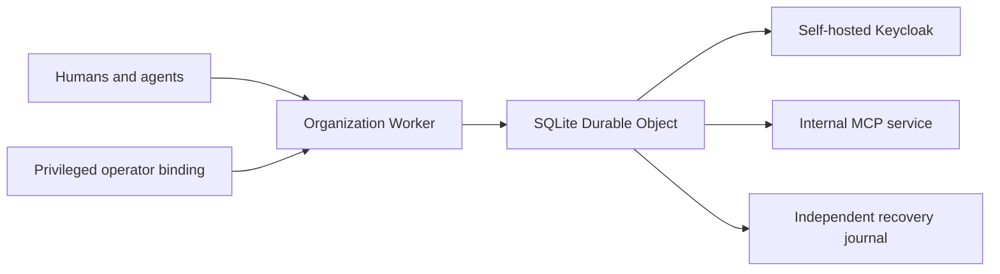

# Cloudflare staging preparation

Status: approved private smoke passed, 11 October 2026. The user has an existing Cloudflare account. Read-only `wrangler whoami` succeeded and returned one account; identifiers and credentials are kept outside the repository. The account-availability answer authorized planning only; the subsequent explicit approval permits the bounded private smoke below. Purchases, DNS changes and production adoption remain unapproved. The CLI identity check is not a billing-plan or deployment-permission audit. [Cloudflare documents `whoami` as a user-information command](https://developers.cloudflare.com/workers/wrangler/commands/general/#whoami).

## Intended deployment

The existing Keycloak choice remains. Cloudflare-native XEIP does not supply a Keycloak server or make the internal MCP service reachable. The recovery journal needs an accepted independent failure boundary. A second object in the same account alone does not establish protection against account/provider loss.

## Stage 1: private packaging smoke

Approved and deployed resource name: `xeip-staging-20261011`, verified absent immediately before creation. Create a separate Worker and its own SQLite Durable Object namespace, with no production binding or data. Keep `workers_dev:false`, preview URLs disabled and `routes:[]`. Do not deploy conformance Workers, arbitrary SQL/fault interfaces, a public administration route or the reconstruction module. Do not enable the refresh scheduler until a real feed is configured.

Prepare and review the exact account pin, public profile, artifact manifest/hashes, new namespace migration and operator-only binding before any deployment request. The current recovery-enabled offline package is locally verified; its example URLs and identities are not a live profile. The builder and owner tooling are described in [the Worker guide](../../services/organization/cloudflare/WORKER.md).

An approved private smoke would check the deployed package, named private binding and uninitialized status without enrolling a real organization. Record the deployment ID, exact code/configuration hashes, account and permission scope, response and usage. Do not interpret an uninitialized smoke as authentication, workload or recovery acceptance. Do not reset/delete a stateful namespace as a rollback shortcut; stop routing and preserve evidence if a later initialized deployment fails.

The bounded exception and explicit approval below apply only to this completed private smoke. Before any wider deployment, complete current-source verification and resource acceptance, inspect the account's plan/capacity and permissions, and prepare the real workflow configuration and usage budget. Account existence alone does not close these inputs.

## Stage 2: real workflow and operational acceptance

Supply real Keycloak issuer/client configuration and human login, test agent identities and memberships, signed trust publisher/custody, the internal MCP endpoint/private route, and a separately hosted journal with its own credential. Keep secret values in protected custody, outside public profile/artifacts and source control. A staging hostname/access policy is needed before any public route is proposed.

Complete organization capture, private export/offline verification and fixed-cut reconstruction of lifecycle, trust, authority, administration and actions are now implemented locally. Reconstructed databases stay blocked by design. Independent action/control receipts, later-journal reconciliation, external execution fencing and safe activation remain required before a full disaster drill. The current 10,000-action cap lasts about 83 minutes at 120 new actions/minute; administrative history also caps at100000 records. Replay-preserving retention is required for sustained rollout. These newer local capabilities have not updated the approved private smoke deployment.

Run the accepted 500-user/200-agent/120-action-request-per-minute workload with live identity checks and durable journal acknowledgements. Measure successful machine-operation P95 ≤2 seconds separately from human review, and report rejections/timeouts alongside latency. Include live traffic during large backup captures; isolated capture timing does not establish that concurrent workload. Exercise full restore ≤1 hour, acknowledged-action retention, unfinished/consumed claims, lost responses, source rollback and the agreed disaster boundary. Verify monitoring, alerts, credential rotation, operator recovery and the organizational pilot. Preserve exact artifacts and all failed evidence. The overloaded workstation is not the acceptance host.

## Cost and resource boundary

Cloudflare currently offers SQLite Durable Objects on both Free and Paid plans; exceeding Free quotas causes operations to fail. This makes a small private experiment potentially possible without changing a plan, but does not establish capacity or zero incremental cost in an already paid account. [Durable Objects pricing](https://developers.cloudflare.com/durable-objects/platform/pricing/).

Do not use the Free tier as the rollout cost model. At 120 new actions/minute for 24 hours, proposals alone total 172,800/day, before approval, execution, inspection, refresh and journal traffic. Workers Free currently allows 100,000 requests/day with 10 ms CPU/invocation; the Paid subscription starts at $5/month and usage/storage charges may apply. These are published dimensions, not a XEIP bill estimate. Measure request fan-out, CPU, active object duration and SQL read/write amplification, including full-history reconciliation, then present a budget before any plan change or load run. [Workers pricing](https://developers.cloudflare.com/workers/platform/pricing/).

## Preparation evidence

- Wrangler account identity: read-only success; one account. No login, deployment or account mutation performed.
- Current Worker artifact: 987838 bytes, SHA256 `58610a5bf7fe8cd281934939c8edbb17bb24d6031c9790b1a0b0d319a9545f5c`; exact manifest/permissions and Worker/scheduler dry-runs passed. Public example profile only.
- [Current reconstruction ledger](cloudflare-action-restore.md) records review, corrected migration/timing tests, image verification and the ongoing full-suite investigation. Its results must be resolved rather than replaced by a cloud smoke.
- [Production decision and ordered gates](../../PRODUCTION_READINESS.md#release-decision-and-next-priorities) remain no-go.

## Approved private smoke candidate

The read-only name check returned Cloudflare error 10007 (“Worker does not exist”) for `xeip-staging-20261011` in the single authenticated account. Recheck immediately before any approved creation to avoid overwriting a resource created meanwhile.

| Proposed action             | Exact scope                                                                                                                      |
| --------------------------- | -------------------------------------------------------------------------------------------------------------------------------- |
| Create Worker               | `xeip-staging-20261011`, pinned to the authenticated account ending `88d683`                                                     |
| Create storage binding      | One new SQLite Durable Object namespace for `OrganizationObject`, isolated from any existing Worker                              |
| Set one Worker secret       | `XEIP_CREDENTIALS`, freshly generated synthetic values used only for configuration parsing                                       |
| Invoke private owner status | At most 5 read-only `status` calls through the named `OwnerEntrypoint`; account pin carried explicitly into the operator process |
| Inspect result              | Deployment/version metadata and the exact uninitialized status; preserve all failures                                            |

The reviewed artifact has `workers_dev:false`, `preview_urls:false`, no routes, and an empty Cron list. It has no recovery enrollment or trust feed. The profile uses the reserved example domains/public example identity, and cannot represent a real organization. No owner initialization, trust update, action, tool call, real credential, DNS change, paid-plan change or load run belongs to this smoke. Do not reuse this profile for the real workflow: recovery must be configured before initialization. The deployment may consume the account's existing Workers/DO quota; this is not an approved production budget.

The exact candidate passed local native private status (`uninitialized`) with **zero outbound requests**, manifest/file-mode checks, and a Wrangler deployment dry-run. It contains only production Worker code; local test caller/fault controls are not included. Worker 987838 bytes/SHA256 `58610a5bf7fe8cd281934939c8edbb17bb24d6031c9790b1a0b0d319a9545f5c`; account-pinned configuration 1356 bytes/SHA256 `4c6fdf766e8855ffb765a6f0993c7f7865c2e87cc9ee4a67e8a91655f79eccb2`. The protected artifact and synthetic-secret files are outside the repository; local pointer `/tmp/xeip-private-staging-candidate.path`, preparation evidence `/tmp/xeip-private-staging-prepare.log`.

Ruling: the outstanding broad-suite performance/startup failures prevent release certification, but do not prevent preparing this bounded, uninitialized package smoke for explicit approval. Its local exact-artifact behavior has been verified independently. Cost if wrong: the hosted smoke can fail; it must remain private and uninitialized, with evidence preserved. This replaces the earlier requirement to finish all unrelated broad regression investigation before submitting even this limited smoke; full workflow/production gates remain unchanged.

**Approved by the user on 11 October 2026** for the exact bounded scope above. The earlier account answer authorized planning only; the separate private-smoke approval now permits these cloud resource changes. Leave the new private inactive resource for review if the smoke fails, rather than deleting state as a recovery shortcut. No deployment has occurred during preparation.

## Hosted execution evidence

The immediately preceding collision check again returned10007 (Worker absent). Exact prepared artifact hashes, file permissions, account pin and private routing were revalidated before creation. Wrangler4.116.0 deployed the approved Worker successfully, reporting **no targets deployed**, one OrganizationObject binding and initial version `82df9b32-d735-42a2-9e3b-305bf7fe053d`. Only the prepared `XEIP_CREDENTIALS` synthetic secret was uploaded; the command reported exactly one successful secret. No public route, scheduler or organization initialization was requested.

The first and only private status attempt completed with exit0 and a validated, correlated receipt: `ok:true`, `state:uninitialized`, `trust:null`, `authority:null`. One of the five permitted status attempts was used; no additional calls are needed. The protected local attempt ledger and receipt preserve this evidence. Deployment inspection shows the synthetic-secret change created current version `4f93b791-03ca-4652-9df9-3a446eb9e62d` at2026-10-11T13:01:39.928Z with100% allocation. JSON metadata confirms current deployment `80e37a2f-01c3-4922-970c-2b7421b142d4`; the initial upload deployment was `ebc6875b-bfc5-4a95-80e5-b2d921f8fed2`. Raw logs remain outside source control: `/tmp/xeip-private-staging-{deploy,secret,status-1,deployments}.log`. The approved smoke is complete: hosted package startup, named private operator binding and uninitialized status work. No authentication/workflow/capacity/restore acceptance follows. Exact billable usage was not measured; one application status RPC was issued, in addition to deployment and management traffic.
